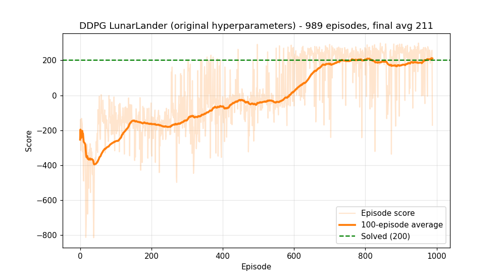

# DDPG — Continuous LunarLander (PyTorch)

A learning repo: I'm studying **Deep Deterministic Policy Gradient (DDPG)** by running, reading,
and modifying a reference implementation. My changes and training results are tracked in the commit history.

## Credit

The original code is by **Phil Tabor (Machine Learning with Phil)**, not me:

- Video: [Reinforcement Learning in Continuous Action Spaces | DDPG Tutorial (Pytorch)](https://www.youtube.com/watch?v=6Yd5WnYls_Y)
- Source: [`philtabor/Youtube-Code-Repository` → `ReinforcementLearning/PolicyGradient/DDPG/pytorch/lunar-lander`](https://github.com/philtabor/Youtube-Code-Repository/tree/master/ReinforcementLearning/PolicyGradient/DDPG/pytorch/lunar-lander)

The first commit is an unmodified copy of it (upstream commit `eb3aa97`). It's shared here for educational purposes only. If you're the author and want it taken down, open an issue.

## What DDPG does here

LunarLander-Continuous has **2 real-valued actions** (main and side engine throttle in [-1, 1]), so DQN's
`argmax` over actions doesn't work. DDPG instead learns:

| Component | Role |
|---|---|
| **Actor** μ(s) | outputs the action directly (`tanh` → [-1, 1]) |
| **Critic** Q(s, a) | scores state-action pairs; the actor follows its gradient |
| **Target networks** | slow copies (τ = 0.001) that stabilise the Bellman target |
| **Replay buffer** | 1M transitions, random minibatches of 64 |
| **OU noise** | temporally correlated exploration noise |

Hyperparameters (unchanged from the original): actor lr 2.5e-5, critic lr 2.5e-4, γ = 0.99, layers 400/300.

## Running it

```bash
pip install torch gymnasium "box2d==2.3.10" matplotlib
python3 main_torch.py          # 1000 episodes (default)
python3 main_torch.py 10       # quick smoke test
python3 live_monitor.py        # live learning-curve window (reads train.log)
```

To log while training: `python3 -u main_torch.py > train.log`.

## Changes from the original

See `git log` for the full history. So far:

1. **Compatibility only** (`c2b64ec`): `gym` → `gymnasium`, `LunarLander-v3`, new `reset`/`step` API,
   CPU fallback instead of `cuda:1`. No algorithm changes.
2. `live_monitor.py` / `watch_live.py`: live training curve and simulation viewers (my additions).
3. `resume_torch.py`: continue training from the last checkpoint (my addition; replay buffer is not restored).

## Progress log

| Date | Run | Result |
|---|---|---|
| 2026-11-12 | Original hyperparameters, CPU, run 1 | **Solved.** 100-ep avg first ≥ 200 at episode 732; peak avg 212.7 (ep 986); best episode 298.8. Stopped at ep 988 (session ended). [`results_run1.png`](results_run1.png), [`results_run1.log`](results_run1.log) |
| 2026-11-12 | Run 1 resumed from ep-975 checkpoint (`resume_torch.py`), eps 976–999 | Completed 1000 episodes; final 100-ep avg **181.7**. Resumed episodes averaged 89.8 (10/24 > 200) vs ~200 before: the original code doesn't save the replay buffer, so learning restarted from an empty buffer. [`results_full.png`](results_full.png), [`results_full.log`](results_full.log) |

Reference result from the original author (`Torch-LunarLander-alpha000025-beta00025-400-300.png`):
the 100-episode average reaches ~200 (solved) around episode 650.


